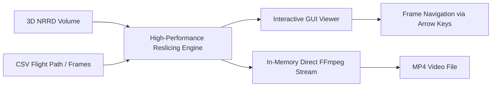

# 3D to 2D Volumetric Reslicing and Projection Engine

A high-performance Python desktop application for extracting, projecting, and rendering 2D image slices from 3D volumetric discrete grid data (`.nrrd`), guided by dynamic geometric spatial coordinates defined in external CSV files.

📺 **[Watch the Project Demo on YouTube](https://youtu.be/6RqctqjyP-c)**

---

## 1. Problem Statement

Volumetric 3D imaging formats such as **NRRD (Nearly Raw Raster Data)** store 3D scalar fields as dense regular voxel grids $V(x, y, z)$ (commonly used in medical MRI/CT scans, computational physics, and industrial inspection). While traditional slicing viewers only support axis-aligned orthogonal cuts (axial, coronal, and sagittal planes), real-world inspection trajectories often require **arbitrary planar and oblique cross-sections** positioned and oriented flexibly within Euclidean 3D space.

```
          Z
          ▲
          │       ┌──────────────────┐
          │      /                  /│
          │     /     3D VOXEL     / │
          │    ┌──────────────────┐  │
          │    │      SPACE       │  │
          │    │    (NRRD Grid)   │  │
          │    │                  │  │
          │    │   /▲\ [P1,P2,P3] │  │     Sampling &
          │    │  /───\ (Triangle)│  │ ──────────────────►  [ 2D Matrix Frame ]
          │    │  /   \           │ /      Interpolation          (W x H)
          │    │ /=====\ [P1..P4] │/
          │    │ (Trapezoid Plane)│
          │    └──────────────────┘
          └─────────────────────────────► X
              \
               \
                ▼ Y
```

### The Core Challenge
The application addresses the problem of reconstructing a continuous sequence of 2D visual frames from a static 3D voxel volume according to an external motion path or spatial trajectory:
1. **Volumetric Ingestion**: Efficiently loading and storing large 3D matrices (up to $500 \times 500 \times 500$ voxels) in memory.
2. **Arbitrary Planar Geometry**:
   - **3-Point Planes**: Represented as spatial **isosceles triangles** defined by 3 vertices $(P_1, P_2, P_3) \in \mathbb{R}^3$.
   - **4-Point Planes**: Represented as spatial **isosceles trapezoids** defined by 4 coplanar vertices $(P_1, P_2, P_3, P_4) \in \mathbb{R}^3$.
3. **Discrete Coordinate Sampling**: Mapping every discrete pixel $(u, v)$ on the target 2D image grid back to its continuous 3D source coordinate $(x, y, z)$ within the volume using vector basis normalization, directional basis vectors, and interpolation.
4. **Boundary & Out-of-Bounds Handling**: Properly evaluating target planar points that lie partially or entirely outside the volume boundaries (e.g., negative coordinates or coordinates exceeding grid limits) by defaulting to background zero values without performance degradation or system exceptions.

> [!TIP]
> For the complete mathematical formulation, scanline centering derivation, geometric constraints, and pseudo-code, see the detailed [Planar Reslicing Algorithm Specification](docs/algorithm_explanation.md).

---

## 2. Project Scope

The project delivers a standalone, production-ready desktop tool engineered for speed, interactive usability, and zero-overhead export pipelines.



### In-Scope Capabilities

* **Data Ingestion**:
  * Parsing standard `.nrrd` headers and loading uncompressed/gzipped 3D scalar arrays.
  * Robust parsing of `.csv` trajectory files specifying sequential frame geometries.
* **Geometric Projection Engine**:
  * Automatic detection and mathematical validation of 3-point (triangle) and 4-point (trapezoid) planar definitions.
  * Orthonormal basis calculation and vector transformation for arbitrary plane slicing.
  * Fast voxel interpolation with out-of-bounds safety clipping.
* **Interactive Graphical User Interface (GUI)**:
  * Minimalist, responsive UI for selecting and loading the `.nrrd` volume and `.csv` coordinate files.
  * Status feedback during processing phases.
  * Smooth 2D frame display with keyboard scrubbing (`Left Arrow` / `Right Arrow`) for manual inspection.
* **Direct-to-Video Streaming Export**:
  * Automated synthesis of the processed 2D frame sequence into an H.264/MP4 video file via `ffmpeg`.
  * **Zero Disk I/O Pipeline**: Raw frame bytes are piped directly into the `ffmpeg` standard input (`stdin`) buffer in memory, strictly avoiding intermediate disk writes of PNG/BMP files.
* **Performance Benchmarks**:
  * Real-time slicing engine operating at $\ge 100\text{ FPS}$ (maximum computation latency of $\le 10\text{ ms}$ per frame).
  * Contiguous 1D flat array representation in memory to maximize CPU L1/L2 cache hit ratios.

---

## 3. High-Level Architecture

```
├── User Interface Layer (GUI)
│   ├── Volume & CSV File Loaders
│   ├── Frame Canvas Viewer
│   └── Keyboard Navigation Handler (Arrow Keys)
│
├── Core Computation Layer
│   ├── NRRD Parser & Contiguous Memory Manager
│   ├── CSV Geometry Trajectory Parser
│   └── Plane Reslicing Engine (Isosceles Triangle & Trapezoid Solvers)
│
└── Export & Output Layer
    ├── Raw Frame Aggregator
    └── Memory-to-FFmpeg Stdin Video Encoder
```

---

## 4. Execution & Usage

### 4.1 CLI Demo Execution
The pipeline can be executed directly via the command-line interface without opening the GUI:
```bash
python Ex0.py <file.nrrd> <file.csv> <file.mp4>
```
* `<file.nrrd>`: Path to the 3D volumetric input dataset (`.nrrd`).
* `<file.csv>`: Path to the trajectory coordinate file (`.csv`).
* `<file.mp4>`: Path to the output video file rendered directly via FFmpeg.

### 4.2 Desktop GUI Execution
To launch the interactive GUI viewer with keyboard navigation (`Left` / `Right` arrows):
```bash
python main.py
```

### 4.3 Video Demo
A walkthrough and demonstration of the project in action is available on YouTube:
* [3D to 2D Volumetric Reslicing Engine - Project Demo](https://youtu.be/6RqctqjyP-c)

---

## 5. Technology Stack

* **Language**: Python 3.10+
* **Numerical Core**: [NumPy](https://numpy.org/) (High-performance array operations and contiguous memory vectorization)
* **Volumetric I/O**: [pynrrd](https://github.com/mhe/pynrrd)
* **Image & Text Rendering**: [Pillow (PIL)](https://python-pillow.org/)
* **GUI Framework**: Tkinter (Standard library, zero-dependency)
* **Media Encoding**: [FFmpeg](https://ffmpeg.org/) (Direct in-memory stdin pipe)
* **Testing Framework**: [pytest](https://pytest.org/)

---

## 6. Directory Structure

```plaintext
I2SE_Exe1/
├── data/                                    # Sample datasets (.nrrd) and trajectory definitions (.csv)
│   ├── MRHead_1.nrrd                        # 3D MRI scan of human head
│   ├── head.csv                             # Trajectory coordinate definitions for MRHead_1
│   ├── onion.nrrd                           # 3D micro-CT scan of an onion
│   ├── onion.csv                            # Trajectory coordinate definitions for onion
│   ├── biscuit_cake.nrrd                    # 3D scan of a biscuit cake
│   ├── biscuit_cake.csv                     # Trajectory coordinate definitions for biscuit cake
│   ├── croissant.nrrd                       # 3D scan of a croissant
│   ├── croissant.csv                        # Trajectory coordinate definitions for croissant
│   ├── swiss_roll.nrrd                      # 3D scan of a swiss roll
│   ├── swiss_roll.csv                       # Trajectory coordinate definitions for swiss roll
│   ├── car.nrrd                             # Synthetic 3D vehicle dataset
│   ├── lecturer_example.csv                 # Lecturer example trajectory definitions
│   ├── sample_trajectory.csv                # Sample trajectory definitions
│   └── edge_cases.csv                       # Edge-case and invalid geometry test trajectories
├── docs/                                    # Technical documentation & specifications
│   ├── algorithm_explanation.md             # Mathematical algorithm specification & pseudo-code
│   ├── software_requirements_specification_srs.md  # Formal SRS document
│   └── testing_strategy.md                  # Black-Box testing strategy & verification plan
├── src/                                     # Core application source modules
│   ├── __init__.py
│   ├── geometry.py                          # 3D vector calculations and shape validation
│   ├── reslicer.py                          # Vectorized 2D planar slicing engine (>= 100 FPS)
│   ├── volume_io.py                         # Contiguous 1D memory ingestion for NRRD volumes
│   ├── csv_parser.py                        # Trajectory parser with header & error detection
│   ├── error_renderer.py                    # Fallback black frame generator with Pillow text
│   ├── video_streamer.py                    # Zero disk I/O FFmpeg stdin video encoder
│   └── gui.py                               # Tkinter interactive desktop viewer
├── tests/                                   # Automated test suite (pytest)
│   ├── test_reslicing_blackbox.py           # 12 specification-based blackbox test cases
│   └── test_demo_cli.py                     # 5 End-to-End CLI demo verification tests
├── video_output/                            # Generated MP4 video outputs from GUI/CLI
│   └── test.mp4                             # Sample generated video output
├── Ex0.py                                   # Executable CLI demo (python Ex0.py <nrrd> <csv> <mp4>)
├── main.py                                  # Desktop GUI launcher (python main.py)
├── output_demo.mp4                          # Default CLI demo output video
└── README.md                                # Project overview, problem description, & scope
```

---

## 7. Specification & Requirements Reference

* **Algorithm Specification**: Detailed mathematical formulation, scanline centering logic, exception validation, and pseudo-code can be found in the [Planar Reslicing Algorithm Specification](docs/algorithm_explanation.md).
* **Testing Strategy**: Equivalence partitioning, boundary value analysis, and black-box verification test cases are detailed in the [Black-Box Testing Strategy](docs/testing_strategy.md).
* **Software Requirements**: Exhaustive functional criteria, non-functional latency/throughput benchmarks, and architectural design are detailed in the [Software Requirements Specification (SRS)](docs/software_requirements_specification_srs.md).

---

*This software was developed in collaboration with **Antigravity** (Google DeepMind).*


